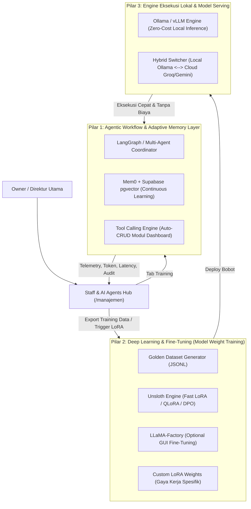

# Master Blueprint: Ekosistem AI Otomasi Lengkap (Agentic, Fine-Tuning & Monitoring Hub)
## Integrasi Penuh: Staff & AI Agents Hub (`/manajemen`)

Dokumen ini merupakan cetak biru terpadu yang menggabungkan seluruh pilar teknologi (Open-Source Agentic Workflow, Deep Learning Fine-Tuning, Local Engine) dengan antarmuka **Tab Training** dan **Tab Monitoring** di **Staff & AI Agents Hub**.

---

## 1. Arsitektur 3 Pilar Utama

---

## 2. Rincian Implementasi 3 Pilar di Proyek

### Pilar 1: Agentic Workflow & Continuous Learning (Otak Eksekusi)
* **Teknologi**: `@langchain/langgraph`, `mem0ai`, dan Supabase `pgvector`.
* **Fungsi Utama**:
  * **LangGraph**: Menjalankan alur multi-step secara otonom (Menerima perintah $\rightarrow$ Analisis SOP $\rightarrow$ Eksekusi Modul Dashboard $\rightarrow$ Validasi Hasil).
  * **Mem0 + Supabase**: Setiap kali Anda mengajari atau mengoreksi agen (contoh: *"Silvi, kalau buat tagihan di atas 10 juta harus sertakan PPN"*), sistem akan menyimpan preferensi tersebut ke tabel memori vektor. Agen langsung mengingatnya secara permanen tanpa perlu melatih ulang model dari nol.
  * **Tool Use Controller**: Eksekutor CRUD otomatis untuk modul *Tugas & Kalender*, *CRM & Klien*, *Keuangan*, *Data & Arsip*, dan *Sasaran & KPI*.

### Pilar 2: Deep Learning & Fine-Tuning (Pelatihan Bobot Model)
* **Teknologi**: **Unsloth** (Python), Hugging Face TRL, dan **LLaMA-Factory**.
* **Fungsi Utama**:
  * **Dataset Harvesting**: Semua dialog dan koreksi dari Tab Training di dashboard secara otomatis diformat menjadi dataset percakapan standar ShareGPT/Alpaca (`.jsonl`).
  * **Fine-Tuning LoRA/DPO (Direct Preference Optimization)**: Melatih model open-source (seperti `Qwen 2.5 Coder 7B/14B` atau `Llama 3.1 8B`) menggunakan Unsloth (sangat hemat VRAM hingga 80%, bisa jalan di GPU biasa atau Google Colab gratis).
  * **Hasil Akhir**: Model memiliki gaya komunikasi natural, pemahaman istilah kantor Anda, dan akurasi *JSON Function Calling* yang sempurna.

### Pilar 3: Engine Eksekusi Lokal & Tool Serving (Inference Gratis & Aman)
* **Teknologi**: **Ollama** atau **vLLM**.
* **Fungsi Utama**:
  * Menjalankan model hasil fine-tuning secara lokal di komputer/server sendiri (100% gratis, aman tanpa data keluar).
  * **Hybrid Failover**: Jika beban lokal tinggi atau komputer offline, sistem secara otomatis beralih (*fallback*) ke API ultra-cepat gratis seperti Groq (Llama-3.3-70B) atau Gemini Flash.

---

## 3. Integrasi ke Antarmuka "Staff & AI Agents Hub"

Di halaman dashboard `/manajemen`, modul **Staff & AI Agents Hub** akan memiliki navigasi tab lengkap:
1. `Semua Personil`
2. `Staf Manusia`
3. `Persona AI Agents`
4. **`Training & Uji AI` (Sub-Modul Baru)**:
   * **Live Training Playground**: Uji coba skenario kompleks terhadap persona AI (Arga, Reta, Silvi, Raka).
   * **Pilar Selector (Model & Engine)**: Memilih backend eksekusi: *Lokal Ollama (Fine-Tuned)* vs *Groq Cloud* vs *Gemini Cloud*.
   * **Teaching & Memory Reinforcement (Mem0)**: Tombol "Koreksi & Ajarkan". Sekali klik, aturan langsung ditanamkan ke memori agen.
   * **Export Golden Dataset**: Tombol 1-klik untuk mengunduh dataset JSONL siap latih untuk Unsloth.
5. **`Monitoring & Telemetri` (Sub-Modul Baru)**:
   * **Token & Kapasitas**: Metrik real-time konsumsi token (Input, Output, Total Biaya/Kapasitas) per agen.
   * **Growth & Intelligence Index (IQ/Reliability Score)**: Grafik skor ketepatan eksekusi tugas AI.
   * **Latency & Execution Speed**: Grafik kecepatan respon (ms) per model/engine (Ollama vs Groq vs Gemini).
   * **Live Activity & Audit Feed**: Log menyeluruh setiap perintah otomatis yang dikerjakan AI, modul dashboard yang tersentuh, status keberhasilan, dan jumlah token yang dipakai.

---

## 4. Tahapan Eksekusi Teknis

1. **Langkah 1 (Store & Schema)**:
   * Perluas `src/store/workspaceStore.js` dengan state `aiTelemetry` (token tracking, latency, success audit) dan `aiTrainingDatasets` (riwayat latihan dan memory rules yang diajarkan).
2. **Langkah 2 (UI Integration)**:
   * Tambahkan tab `training` dan `monitoring` pada header `StaffAgent.jsx`.
   * Bangun komponen antarmuka **Training & Lab Playground** lengkap dengan mode koreksi memori dan export dataset.
   * Bangun komponen antarmuka **Monitoring & Telemetry Dashboard** lengkap dengan visualisasi token, latency, dan audit log.
3. **Langkah 3 (Koneksi Engine & Memory)**:
   * Siapkan adapter panggilan model (Ollama / Local vLLM / Groq / Gemini) dan struktur penyimpanan memori vektor.
