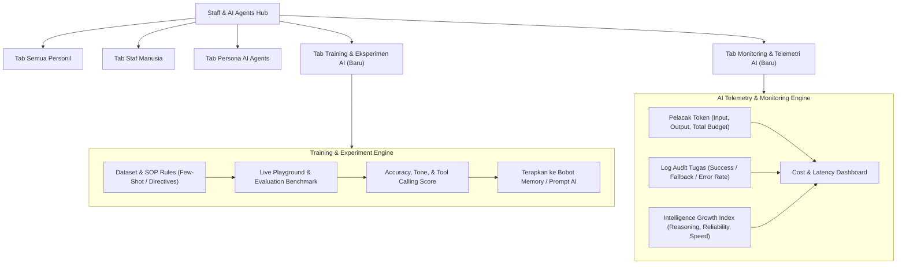

# Blueprint & Arsitektur Implementasi: AI Training Hub & Monitoring Dashboard
## Modul: "Staff & AI Agents Hub" (`/manajemen`)

Rencana ini merinci penambahan dua sub-modul utama di dalam **Staff & AI Agents Hub**:
1. **Tab Training (Ruang Eksperimen & Pembelajaran AI Real)**
2. **Tab Monitoring (Telemetry, Token Usage, Intelligence Growth, & Task Audit)**

---

## 1. Arsitektur Komponen & Alur Data

---

## 2. Fitur Detail Tab Training (Eksperimen & Pelatihan AI Nyata)

### A. Fitur Eksperimen Interaktif (Live Lab Playground)
1. **Model & Persona Selector**:
   * Pilih agen yang ingin dilatih (misal: *Arga - Project Director*, *Reta - Creative*, *Silvi - Financial & CRM*, *Raka - Tech Support*).
   * Pilih model dasar (*Llama 3.3 70B via Groq*, *Gemini 2.0 Flash*, *Mistral Small*, atau *Custom Local vLLM/Ollama*).
2. **Interactive Training Scenario**:
   * Pengguna memberikan instruksi/studi kasus sulit (contoh: *"Klien komplain tagihan salah Rp 15.000.000 dan minta diskon mendadak, bagaimana responmu dan aksi apa yang dibuat di modul Keuangan?"*).
   * Tombol **"Jalankan Simulasi & Evaluasi"**.
3. **Dual Feedback & Teaching Tool**:
   * Hasil output AI dipecah menjadi: **Analisis Respon Bahasa**, **Rencana Tool Calling (Modul yang disentuh)**, dan **Tingkat Kepatuhan SOP**.
   * Fitur **"Koreksi & Ajari AI" (Reinforcement Feedback)**: Pengguna dapat mengoreksi langsung jawaban AI yang kurang pas. Koreksi ini langsung disimpan ke `mem0 / memory store` persona agen tersebut sehingga AI tidak mengulangi kesalahan yang sama.
4. **Dataset & Few-Shot Library**:
   * Daftar contoh kasus ideal (*Golden Dataset / Benchmark Q&A*).
   * Import/Export dataset format JSONL untuk fine-tuning Unsloth/LoRA di masa mendatang.

---

## 3. Fitur Detail Tab Monitoring (Perkembangan Kecerdasan & Kapasitas Token)

### A. Metrik Utama (Metric Cards)
1. **Total Token Terkonsumsi**: Pemakaian token hari ini, minggu ini, dan kumulatif (Input + Output).
2. **Tingkat Akurasi Eksekusi Tugas (Success Rate)**: Persentase tugas yang berhasil dieksekusi otomatis tanpa intervensi manual (contoh: 96.8%).
3. **Rata-rata Waktu Respon (Latency)**: Latensi rata-rata eksekusi per agen (contoh: 420ms).
4. **Indeks Kecerdasan & Adaptasi (Agent IQ / Reliability Index)**: Skor kumulatif berdasarkan keberhasilan pemecahan masalah dan feedback positif dari Owner.

### B. Visualisasi Telemetri & Analisis (Charts)
1. **Token & Capacity Usage Chart**:
   * Grafik bar/line penggunaan token per AI Agent (Arga vs Reta vs Silvi vs Raka).
   * Estimasi kapasitas kuota API (misal batas TPM/RPM Groq atau Gemini).
2. **Sebaran Kategori Tugas Otomatis**:
   * Donut chart distribusi aksi: *Pembuatan Jadwal*, *Penyusunan Kontrak/Arsip*, *Update CRM Prospek*, *Penyusunan KPI*, *Auto-Audit Sistem*.
3. **Jejak Audit Aktivitas & Riwayat Eksekusi (Live Audit Feed)**:
   * Tabel interaktif berisi: Waktu, Nama Agen, Aksi Otomatis, Modul yang Dimodifikasi, Jumlah Token yang Terpakai, Status (*Sukses*, *Perlu Review*, *Diperbaiki*).

---

## 4. Rencana Eksekusi Kode
1. **Store Update (`src/store/workspaceStore.js`)**:
   * Menambahkan state `aiTelemetry` (data konsumsi token, log eksekusi, skor performa) dan `aiTrainingDatasets` (riwayat latihan dan memory rules yang diajarkan).
2. **Komponen UI di (`src/pages/dashboard/modules/StaffAgent.jsx`)**:
   * Menambahkan opsi tab baru di navigation bar: `Training & Uji AI` dan `Monitoring & Telemetri`.
   * Merender antarmuka **Training Lab** saat tab training aktif.
   * Merender antarmuka **Telemetry & Token Monitor** saat tab monitoring aktif.
3. **Persistensi ke Supabase**:
   * Memastikan data training memory dan riwayat token tersimpan aman.
