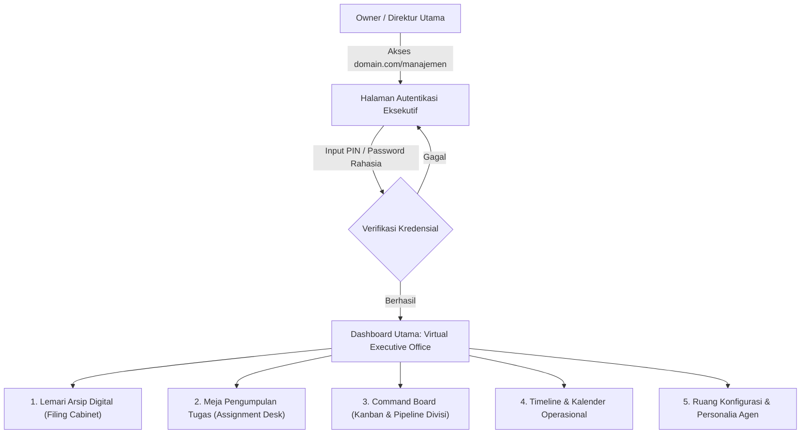

# Blueprint & Konsep: Dashboard Manajemen Kantor Virtual (/manajemen)
## "The Digital Headquarters" - Ruang Kendali Eksekutif & Arsip Perusahaan

Dokumen ini merinci rancangan modul manajemen internal perusahaan (`domain.com/manajemen`) yang mengawinkan fungsionalitas ERP/Manajemen Operasional modern dengan konsep metafora visual kantor nyata: **Meja Tugas, Lemari Arsip Digital, Kanban Board, dan Timeline Eksekutif**.

---

## 1. Alur Akses & Keamanan (/manajemen)



---

## 2. Metafora Visual & Menu Dashboard Perusahaan

### A. Lemari Arsip Digital (*The Filing Cabinet / Vault*)
Di kantor konvensional, setiap perusahaan memiliki lemari besi atau laci arsip berkas penting. Di dashboard ini, lemari digital dipecah per laci divisi:

1. **Laci 1: Legal & Perizinan (Managed by @Admin)**
   - Dokumen Akta Pendirian, NIB, NPWP Perusahaan, PKS (Perjanjian Kerja Sama).
   - Template Surat Perjanjian Klien / Kontrak Kerja Vendor.
   - Tombol: *Export PDF, Salin Teks Hukum, Status Masa Berlaku Dokumen*.
2. **Laci 2: Keuangan & Invoice (Managed by @Admin)**
   - Rekap Pengeluaran & Pemasukan Operasional harian/bulanan.
   - Meja Faktur: Draft Invoice otomatis hasil pembuatan dari chat WhatsApp.
   - Status Tagihan: *Unpaid, Paid, Overdue*.
3. **Laci 3: Brankas Aset Kreatif & Konten (Managed by @Creative)**
   - Arsip Script Iklan & Ide Konten TikTok/Reels yang pernah dibuat.
   - Bank Copywriting (Caption Instagram, Broadcast WhatsApp, Headline Email).
   - Brand Guideline (Warna hex brand, tone of voice, logo pack).
4. **Laci 4: Intelijen & Riset Pasar (Managed by @Research)**
   - Ringkasan Analisis Kompetitor.
   - Rangkuman Tren Kata Kunci & Topik Viral bulanan.
   - Arsip URL & Dokumen referensi eksternal.

---

### B. Meja Pengumpulan Tugas (*The Assignment & Submission Desk*)
Tempat meletakkan hasil kerja mentah yang diserahkan oleh para agen dari WhatsApp sebelum dieksekusi atau disetujui Owner:

- **Baki Masuk (*Inbox Tray*):**
  - Setiap kali Anda memerintahkan agen di WhatsApp (misal: *"@Creative buat script video"*), hasil teksnya otomatis masuk ke baki ini berlabel: `Perlu Review`.
- **Aksi Review Sekali Klik:**
  - `[Setujui & Publikasikan]` $\rightarrow$ Pindah ke arsip siap tayang.
  - `[Minta Revisi]` $\rightarrow$ Membuka kotak feedback yang bisa otomatis meneruskan perintah revisi ke grup WhatsApp bot.
  - `[Arsipkan]` $\rightarrow$ Masuk ke Lemari Arsip Digital.
- **Log Akuntabilitas:** Jam pengerjaan, model AI yang mengerjakan (Groq Llama 3.3 atau Gemini Backup), dan lama waktu pemrosesan.

---

### C. Board Operasional Perusahaan (*The Operational Kanban Board*)
Papan tulis besar (*whiteboard*) kantor yang memantau alur kerja seluruh divisi secara transparan:

| Backlog (Rencana) | In Progress (Sedang Dikerjakan) | In Review (Meja Boss) | Done (Selesai & Rilis) |
| :--- | :--- | :--- | :--- |
| Riset Produk Kompetitor B | @Research sedang scraping | Draft Script Promo Weekend | Invoice Klien PT Jaya Abadi |
| Format Laporan Pajak Q4 | @Creative menulis hook 3 detik | Rekap Absensi Tim Virtual | Broadcast WhatsApp Promo 10.10 |
| SOP Customer Service Baru | @Admin hitung kas kecil | - | Desain Moodboard Oktober |

*Fitur:* Kartu tugas bisa di-drag-and-drop antar kolom, memiliki tag warna per divisi (Biru = Admin, Ungu = Creative, Hijau = Research, Emas = Manager).

---

### D. Timeline & Kalender Kantor (*The Executive Timeline & Calendar*)
Jadwal waktu operasional perusahaan untuk menjaga ritme kerja:

1. **Gantt Chart Jadwal Kampanye:**
   - Visualisasi jadwal peluncuran produk atau kampanye iklan sepanjang bulan.
2. **Jadwal Kerja & Shift Agen Otomatis:**
   - Jam posting konten sosmed yang dijadwalkan oleh @Creative.
   - Jam rekapitulasi data keuangan harian oleh @Admin (misal setiap jam 21.00 WIB).
3. **Pemberitahuan Tenggat Waktu (*Deadline Alert*):**
   - Kartu notifikasi untuk invoice jatuh tempo, perpanjangan domain/server, atau laporan pajak bulanan.

---

### E. Ruang Konfigurasi & Personalia (*Agent Roster & Settings*)
Tempat Direktur Utama mengelola identitas dan hak akses pegawai AI:

- **Kartu Identitas Pegawai (ID Card):**
  - Foto avatar, nama panggilan, jabatan, deskripsi jobdesk, dan instruksi perilaku (*System Prompt*).
- **Pengatur Kunci API & Engine:**
  - Sakelar status: Groq (Llama 3.3) vs Google Gemini (2.5 Flash).
  - Status koneksi Green-API WhatsApp Gateway (Active/Offline).

---

## 3. Struktur Teknis Halaman di Proyek Ini

```text
src/
├── pages/
│   ├── Login.jsx                 <-- Halaman login admin rahasia
│   └── ManagementDashboard.jsx   <-- Pusat kantor virtual (Lemari, Meja, Board)
├── components/management/
│   ├── FilingCabinet.jsx         <-- Komponen lemari arsip & laci dokumen
│   ├── SubmissionDesk.jsx        <-- Baki pengumpulan tugas masuk dari WA
│   ├── KanbanBoard.jsx           <-- Papan alur kerja perusahaan
│   ├── TimelineView.jsx          <-- Kalender & jadwal operasional
│   └── AgentRoster.jsx           <-- Profil dan status divisi pegawai AI
```

---

## 4. Keuntungan Konsep Ini untuk Perusahaan Anda

1. **Sentralisasi Total:** Anda tidak perlu scroll riwayat chat WhatsApp yang panjang untuk mencari hasil kerja minggu lalu; semua otomatis tersusun rapi di Lemari Arsip Digital.
2. **Pendelegasian Tanpa Beban Mental:** Mengontrol pekerjaan layaknya pemilik perusahaan nyata melalui antarmuka visual yang intuitif.
3. **Kredibilitas Profesional:** Anda memiliki sistem ERP / Kantor Digital milik sendiri yang terintegrasi langsung dengan WhatsApp bot dan kecerdasan buatan kelas dunia.
