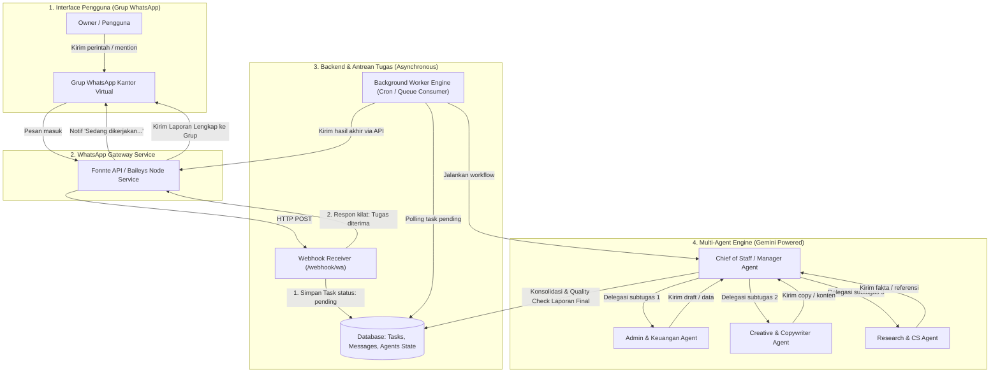

# Blueprint & Roadmap Implementasi: Multi-Agent AI Kantor Virtual via WhatsApp

Dokumen ini adalah rencana kerja bertahap (*step-by-step implementation plan*) untuk membangun tim pegawai AI virtual yang saling berkolaborasi dan dikendalikan sepenuhnya melalui **Grup WhatsApp**.

---

## 1. Arsitektur Solusi & Alur Kerja



---

## 2. Struktur Tim Kantor Virtual (Agents & Responsibilities)

| Nama Agent | Peran / Jobdesk | Tools / Kemampuan | Contoh Perintah di Grup WA |
| :--- | :--- | :--- | :--- |
| **@Manager (Chief of Staff)** | Mengurai instruksi boss, membagi tugas ke agen yang tepat, memantau deadline, dan menyusun laporan akhir. | Task Router, Synthesizer, Quality Assessor | *"Team, buat strategi promo launching produk baru minggu depan"* |
| **@Admin (Keuangan & Ops)** | Pencatatan data, rekapitulasi penjualan, buat draf invoice, template email formal, dan tabel rekap. | Formatter Markdown/Table, CSV/JSON parser, Calculator | *"@Admin tolong buatkan format rekap biaya operasional bulan ini"* |
| **@Creative (Marketing & Copywriter)** | Membuat script video (TikTok/Reels), caption sosmed, copywriting iklan, ide visual banner. | Copywriting frameworks (AIDA, PAS), Headline Generator | *"@Creative buatkan 3 draft caption Instagram carousel edukasi"* |
| **@Research (Riset & Analisis)** | Meringkas artikel/link, riset kompetitor, pengecekan tren kata kunci, dan menyusun data referensi. | Text Summarizer, Search, Fact Verification | *"@Research pelajari link ini dan beri saya poin-poin utamanya"* |

---

## 3. Tahapan Implementasi Bertahap (Step-by-Step)

### Tahap 1: Setup WhatsApp Webhook & Keamanan Grup (Hari 1)
- **Tujuan:** Menghubungkan nomor bot ke WhatsApp dan memastikan bot hanya merespons di grup kantor tertentu (whitelisting).
- **Deliverables:**
  - Akun WhatsApp Gateway (menggunakan Fonnte Token atau Baileys Node server).
  - Skrip endpoint Webhook penerima pesan masuk.
  - Filter pengamanan: mengabaikan pesan pribadi luar dan hanya menerima instruksi dari nomor terdaftar (Owner ID) di Group ID kantor.
- **Indikator Sukses:** Mengirim chat *"ping"* di grup WhatsApp dan bot membalas *"pong"* ke grup.

---

### Tahap 2: Database Task Queue & Manajemen Status (Hari 2)
- **Tujuan:** Menghindari *request timeout* WhatsApp. Pesan langsung disimpan ke database dalam hitungan milidetik, sementara agen AI bekerja di latar belakang.
- **Skema Tabel Database:**
  - `tasks`: `id`, `group_id`, `sender_id`, `instruction`, `status` (`pending`, `processing`, `completed`, `failed`), `assigned_agent`, `result`, `created_at`, `updated_at`.
  - `agent_logs`: `id`, `task_id`, `agent_name`, `log_message`, `step_order`, `timestamp`.
- **Indikator Sukses:** Setiap ada perintah di WA, tersimpan 1 baris antrean di database dengan status `pending`, dan WhatsApp langsung menerima konfirmasi *"Tugas sudah masuk antrean"*.

---

### Tahap 3: Implementasi Agent Manager & Spesialis (Hari 3-4)
- **Tujuan:** Menghubungkan Gemini API dengan logika routing dan persona masing-masing agen.
- **Komponen Kunci:**
  - **System Prompt Per Agen:** Persona yang ketat dan fokus sesuai jobdesk.
  - **Orkestrator Function:** Agent Manager membaca instruksi, memilih agen mana yang bertugas, atau mengeksekusi secara berurutan (misal: Research $\rightarrow$ Creative $\rightarrow$ Review Manager).
- **Indikator Sukses:** Worker memproses baris tugas dari database, memanggil Gemini API dengan prompt agent bersangkutan, dan menyimpan hasil teks final ke database.

---

### Tahap 4: Notifikasi Progres & Laporan ke Grup WhatsApp (Hari 5)
- **Tujuan:** Mengirimkan update berkala dan output final kembali ke grup kantor.
- **Format Pesan Respon:**
  1. *Update Awal:* `[Manager] Tugas diterima: Memproses riset materi konten...`
  2. *Laporan Final:*
     ```text
     [Laporan Selesai - Creative & Research]
     Tugas: Pembuatan 3 Ide Konten TikTok

     Ide 1: Problem-Agitate-Solve
     - Hook: ...
     - Story: ...
     - CTA: ...

     Status: Siap dieksekusi, Boss.
     ```
- **Indikator Sukses:** Seluruh hasil olahan agen muncul langsung di dalam grup WhatsApp secara rapi dan terstruktur.

---

### Tahap 5: Fitur Interaksi Lanjutan & Koreksi (Hari 6+)
- **Tujuan:** Memungkinkan revisi tugas secara interaktif langsung dari chat grup.
- **Fitur:**
  - Membalas (*quote/reply*) pesan hasil kerja bot dengan koreksi (misal: *"Kurang santai bahasanya, tolong perbaiki"*).
  - Sistem mendeteksi `task_id` dari pesan yang di-quote dan melanjutkan siklus revisi.

---

## 4. Persiapan Kebutuhan (Prerequisites)

1. **Google Gemini API Key:** Gratis dari [Google AI Studio](https://aistudio.google.com).
2. **WhatsApp Gateway:** 
   - Opsi praktis: Token Fonnte (tersedia free trial / paket bulanan terjangkau).
   - Opsi mandiri: Layanan Node.js Baileys di VPS lokal.
3. **Runtime:** PHP + MySQL (sesuai skrip yang ada saat ini) atau Node.js / Python.

---

## 5. File Referensi di Proyek Saat Ini

- [`api.php`](file:///c:/Users/j/Documents/Website/agentic-ai/api.php): Webhook listener & API router.
- [`cron-worker.php`](file:///c:/Users/j/Documents/Website/agentic-ai/cron-worker.php): Background worker antrean tugas.
- [`digibooster_office_engine.html`](file:///c:/Users/j/Documents/Website/agentic-ai/digibooster_office_engine.html): Visualisasi 3D status kantor virtual.
