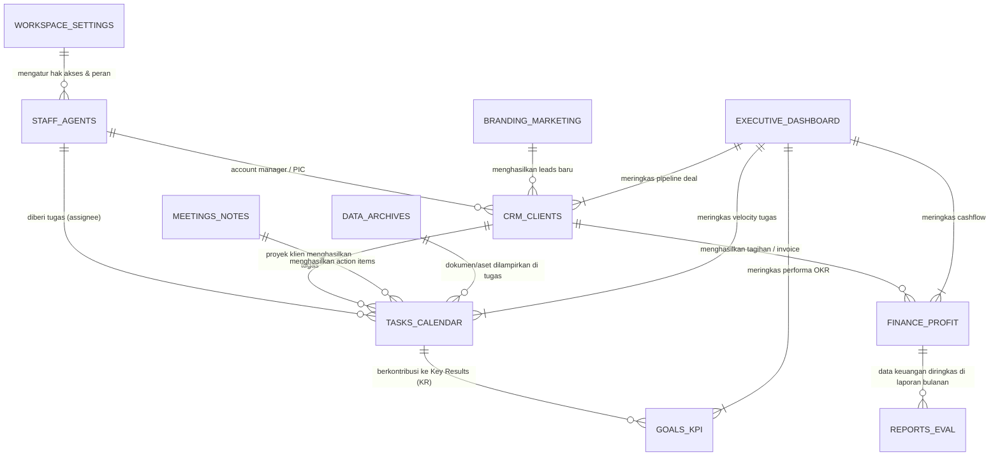

# Cetak Biru Final Workspace DigiBooster (Sistem Manajemen Terpadu Ala Notion)

Dokumen ini adalah standarisasi resmi nama menu, struktur data relasional (Database Schema), relasi antar modul, grafik analitik, serta mekanisme fleksibel CRUD (Tambah, Edit, Hapus, Filter, Multi-view, Export) dan Unduh Berkas untuk sistem Workspace DigiBooster Indonesia.

---

## 1. Arsitektur Relasi Antar Menu (Entity-Relationship & Data Flow)

Kekuatan sistem ala Notion terletak pada **relasi dua arah (Bi-directional Relations)** antar database:



---

## 2. Standarisasi 10 Menu Utama & Rincian Isinya

Setiap menu dilengkapi dengan:
- **Tabel Interaktif Notion:** Input baris fleksibel, edit langsung (inline), modal detail slide-over, hapus, multi-select, sort/filter, dan ekspor CSV/JSON.
- **Multi-View Switcher:** View Tabel, Kanban Board, Kalender, atau Galeri Kartu.
- **Grafik/Widget Metrik:** Chart interaktif berbasis data riil di tabel.
- **Fitur Download/Aksi Cepat:** Unduh laporan, invoice, dokumen, atau ekspor data.

---

### Menu 1: 📊 Executive Dashboard (Ringkasan Eksekutif)
* **Peran:** Pusat kendali C-Level / Direksi untuk memantau kesehatan seluruh perusahaan dalam 1 layar tanpa harus memeriksa satu per satu menu.
* **Komponen & Metrik Utama:**
  1. **Top Metric Cards:**
     - *Net Cashflow Bulan Ini* (diambil live dari Menu Keuangan).
     - *Active Pipeline Value* (total potensi nilai kontrak dari CRM).
     - *Task Velocity & Health* (% tugas selesai tepat waktu).
     - *Rata-rata Capaian OKR* (% progres target kuartal ini).
  2. **Grafik Terpadu:**
     - 📈 **Line/Area Chart:** Pendapatan vs Pengeluaran 6 Bulan Terakhir.
     - 🎯 **Radar / Gauge Chart:** Skor Kesehatan Operasional (Finance, Sales, Marketing, Project Delivery, Team Capacity).
     - 🏆 **Sales Pipeline Stage Funnel:** Nilai uang di tiap fase prospek klien.
     - 🚨 **Action Center & Critical Alerts:** List peringatan otomatis (misal: "2 Invoice Overdue", "1 Proyek Melewati Deadline", "Penyimpanan 85% Penuh").
* **Aksi Cepat:** Tombol *Quick Add Task*, *Quick Add Expense*, dan *Unduh Ringkasan Eksekutif (Executive Summary PDF/CSV)*.

---

### Menu 2: 🤝 CRM & Klien (Manajemen Klien & Prospek)
* **Peran:** Melacak calon klien (leads) dari kontak pertama, pengiriman proposal, negosiasi, kontrak deal, hingga retensi klien berjalan.
* **Struktur Tabel Database (Notion Data Grid):**
  - `Nama Klien / Perusahaan` (Text)
  - `Kontak & WhatsApp PIC` (Phone/Link)
  - `Tahapan Prospek (Stage)` (Select: Lead Masuk, Discovery Call, Proposal Terkirim, Negosiasi, Deal Won 🎉, Lost ❌)
  - `Nilai Potensi Kontrak (Deal Value)` (Currency IDR/USD)
  - `Paket Layanan` (Multi-select: Web Dev, Digital Ads, Social Media, Branding, Custom AI)
  - `PIC Internal` (Relation: Pilih Staff Agent)
  - `Dokumen Kontrak / PKS` (Files & Media: Upload & Unduh PDF Kontrak)
* **Multi-View:**
  - 🗂️ **Pipeline Kanban:** Drag & drop klien dari "Proposal Terkirim" ke "Deal Won".
  - 📋 **Table View:** Daftar tabel detail dengan total penjumlahan nilai kontrak di bawah kolom.
* **Grafik Analitik:**
  - 📊 Bar Chart: *Deal Value per Stage* (Berapa ratus juta potensi yang sedang dinegosiasikan).
  - 🍩 Donut Chart: *Lead Source Distribution* (Instagram, Website, LinkedIn, Referral).
* **Fitur Unduh/Ekspor:** Ekspor Daftar Klien (CSV/Excel) dan Unduh Dokumen Kontrak / NDA / Proposal.

---

### Menu 3: 💰 Keuangan & Profitabilitas (Cashflow & Finansial)
* **Peran:** Mengelola arus kas masuk dan keluar secara transparan, menghitung profit margin per proyek, dan memantau status pembayaran invoice.
* **Struktur Tabel Database:**
  - `Kode / Nama Transaksi` (Text)
  - `Tipe` (Select: Pemasukan / Pengeluaran)
  - `Kategori` (Select: Operasional, Gaji & Honor, Server & Tools, Marketing Ads, Pembayaran Klien, Pajak)
  - `Nominal` (Currency)
  - `Relasi Klien / Proyek` (Relation: CRM & Klien)
  - `Tanggal Transaksi` (Date)
  - `Status Pembayaran` (Select: Lunas / Pending / Jatuh Tempo)
  - `Bukti Bayar / Faktur` (File: Unduh struk/bukti transfer)
* **Multi-View:**
  - 📋 **Table View:** Arus kas harian lengkap dengan kalkulasi Total Income, Total Expense, Net Profit.
  - 🧾 **Invoice Tracker View:** Filter khusus transaksi berstatus Pending / Jatuh Tempo.
* **Grafik Analitik:**
  - 📊 Bar Chart Dual-Axis: *Income vs Expense per Bulan*.
  - 🥧 Pie Chart: *Persentase Pengeluaran Berdasarkan Kategori*.
* **Fitur Unduh/Ekspor:** Unduh Laporan Laba Rugi (CSV/Excel), Unduh Template Invoice, dan Cetak Kwitansi Pembayaran.

---

### Menu 4: 📢 Branding & Marketing (Kampanye & Kalender Konten)
* **Peran:** Eksekusi strategi pemasaran digital, editorial plan media sosial, dan tracking return of investment (ROAS) iklan.
* **Struktur Tabel Database:**
  - `Judul Konten / Kampanye` (Text)
  - `Channel Pemasaran` (Multi-select: Instagram, TikTok, LinkedIn, YouTube, Email, Meta Ads, Google Ads)
  - `Pilar Konten` (Select: Edukasi, Case Study, Promo/Hard Sell, Entertainment, Branding)
  - `Status Produksi` (Select: Ide, Copywriting, Design/Video, Review, Siap Tayang, Selesai Tayang)
  - `Tanggal Publikasi` (Date & Time)
  - `Biaya Iklan (Ad Spend)` (Currency)
  - `Hasil Metrik (Reach / Clicks / Leads)` (Numbers)
  - `Link File Desain / Video` (URL / File Upload)
* **Multi-View:**
  - 📅 **Social Media Calendar View:** Tampilan kalender bulanan tayang konten.
  - 🗂️ **Production Kanban:** Papan alur kerja tim kreatif dari Ide -> Design -> Selesai.
* **Grafik Analitik:**
  - 📈 Line Chart: *Pertumbuhan Reach & Impressions Lintas Channel*.
  - 📊 Bar Chart: *Cost per Lead (CPL) & ROAS per Kampanye Iklan*.
* **Fitur Unduh/Ekspor:** Unduh Editorial Plan Kalender (PDF/Excel) dan Unduh Aset Konten.

---

### Menu 5: 📅 Tugas & Kalender (Manajemen Proyek & Sprint)
* **Peran:** Pusat pembagian kerja tim operasional, sprint mingguan, dan pelacakan deadline setiap proyek.
* **Struktur Tabel Database:**
  - `Nama Tugas` (Text)
  - `Proyek Terkait` (Relation: Pilih dari CRM Klien atau Internal)
  - `Penanggung Jawab (Assignee)` (Relation: Pilih Staff Agent)
  - `Prioritas` (Select: Rendah, Sedang, Tinggi, Mendesak/Urgent)
  - `Status` (Select: Backlog, Sedang Dikerjakan, Menunggu Review, Selesai)
  - `Tenggat Waktu (Due Date)` (Date)
  - `Estimasi Jam vs Jam Aktual` (Number: Time Tracking)
  - `Lampiran Berkas Hasil Kerja` (File: Unduh hasil pengerjaan tim)
* **Multi-View:**
  - 🗂️ **Sprint Kanban Board:** Drag & drop task antar status kerja.
  - 📅 **Kalender Deadline:** Tanggal merah penyerahan tugas.
  - 📋 **Tabel Beban Kerja:** Mengelompokkan tugas per orang (Workload Grouping).
* **Grafik Analitik:**
  - 🍩 Donut Chart: *Persentase Status Tugas (Done vs In Progress vs Overdue)*.
  - 📊 Horizontal Bar: *Distribusi Jam Kerja per Anggota Tim*.
* **Fitur Unduh/Ekspor:** Ekspor Timesheet Kerja (CSV) dan Unduh File Hasil Kerja Tugas Terlampir.

---

### Menu 6: 🎯 Sasaran & KPI (OKR & Kinerja Strategis)
* **Peran:** Menjaga keselarasan sasaran besar perusahaan (Objectives) dengan metrik terukur tim (Key Results) setiap kuartal.
* **Struktur Tabel Database:**
  - `Nama Objective (Sasaran Besar)` (Text)
  - `Key Result (Indikator Kunci)` (Text)
  - `Divisi` (Select: Eksekutif, Sales, Marketing, Operasional/Produksi, HR)
  - `Periode Kuartal` (Select: Q1, Q2, Q3, Q4)
  - `Target Angka` (Number / Currency / %)
  - `Pencapaian Saat Ini` (Number)
  - `Persentase Capaian (Formula Otomatis)`: `(Current / Target) * 100%`
  - `Pemilik Sasaran (Owner)` (Relation: Staff Agent)
* **Multi-View:**
  - 📋 **Tree/Table View:** Pengelompokkan Objective utama beserta daftar anak Key Results-nya.
  - 🏆 **Scorecard View:** Tampilan kartu persentase progres warna-warni (Merah < 50%, Kuning 50-79%, Hijau >= 80%).
* **Grafik Analitik:**
  - 🎯 Bullet Chart / Progress Bar: *Capaian OKR per Departemen*.
  - 📈 Trend Line: *Progres Mingguan Pencapaian Target Kuartal*.
* **Fitur Unduh/Ekspor:** Ekspor Rapor Kinerja Kuartal (PDF/Excel).

---

### Menu 7: 🎙️ Rapat & Catatan (Notulensi & Keputusan)
* **Peran:** Dokumentasi terpusat setiap rapat tim atau klien, mencegah notulensi hilang, dan otomatis mengubah keputusan menjadi tugas.
* **Struktur Tabel Database:**
  - `Judul Rapat` (Text)
  - `Tanggal & Waktu` (Date & Time)
  - `Tipe Rapat` (Select: Internal Weekly Sync, Client Kick-off, Evaluasi Bulanan, 1-on-1)
  - `Peserta Hadir` (Multi-select: Staff Agents)
  - `Link Rekaman / GMeet` (URL)
  - `Isi Notulensi & Poin Utama` (Rich Text / Notion Block Content)
  - `Daftar Tindak Lanjut (Action Items)` (Checklist interaktif yang bisa dikonversi ke Tugas)
* **Multi-View:**
  - 📋 **Tabel Arsip Notulensi:** List pencarian berdasarkan kata kunci atau klien.
  - 📅 **Timeline Rapat:** Jadwal rapat mendatang.
* **Grafik Analitik:**
  - 📊 Bar Chart: *Total Durasi Rapat Tim per Minggu*.
  - 📈 Stat Metric: *Rasio Keputusan yang Berhasil Dieksekusi (% Action Items Done)*.
* **Fitur Unduh/Ekspor:** Unduh Notulensi Lengkap (PDF/Markdown) dan Ekspor Daftar Rapat.

---

### Menu 8: 📑 Laporan & Evaluasi (Review & Business Intelligence)
* **Peran:** Ruang audit performa bulanan, evaluasi retrospektif proyek, analisis kendala (bottleneck), dan dokumentasi perbaikan berkelanjutan.
* **Struktur Tabel Database:**
  - `Nama Laporan / Periode Evaluasi` (Text)
  - `Kategori Evaluasi` (Select: Retrospektif Sprint, Evaluasi Pasca Proyek Klien, Audit Kualitas, Laporan Keuangan Bulanan)
  - `Skor Kepuasan / Nilai Mutu` (Rating: 1 - 5 Bintang)
  - `Apa yang Berjalan Baik (What Went Well)` (Text)
  - `Kendala / Hambatan yang Ditemui (Bottlenecks)` (Text)
  - `Rencana Solusi / Tindakan Perbaikan (Action Plan)` (Text)
  - `Disusun Oleh` (Relation: Staff Agent)
  - `Lampiran Berkas Analitik` (File: Unduh berkas audit)
* **Multi-View:**
  - 📋 **Table View:** Arsip laporan bulanan.
  - 🃏 **Card Feed:** Tampilan kartu insight evaluasi berkala.
* **Grafik Analitik:**
  - 📈 Radar Chart: *Evaluasi Kualitas Proyek Lintas Aspek (Tepat Waktu, Anggaran, Mutu, Komunikasi)*.
  - 📊 Bar Chart: *Tren Frekuensi Kendala Operasional per Bulan*.
* **Fitur Unduh/Ekspor:** Unduh Laporan Evaluasi Bulanan (Format PDF Resmi / Word).

---

### Menu 9: 📁 Data & Arsip (Knowledge Vault & Brand Kit)
* **Peran:** Pusat penyimpanan seluruh aset intelektual, Standard Operating Procedure (SOP), template legal, berkas perusahaan, dan aset grafis.
* **Struktur Tabel Database:**
  - `Nama Dokumen / Aset` (Text)
  - `Kategori Dokumen` (Select: SOP Perusahaan, Template Kontrak & NDA, Legalitas/PT, Brand Assets/Logo/Font, Portofolio)
  - `Format Berkas` (Select: PDF, DOCX, ZIP, Figma, AI/PSD, MP4)
  - `Versi Terakhir` (Text: v1.0, v2.1)
  - `Tanggal Pembaruan` (Date)
  - `Hak Akses` (Select: Publik Semua Tim, Hanya Manager, Rahasia/Direksi)
  - `Aksi Berkas` (Tombol Upload & Tombol Unduh Langsung)
* **Multi-View:**
  - 🃏 **Gallery Cards:** Tampilan thumbnail visual untuk logo & aset desain.
  - 📋 **Tabel SOP & Berkas:** Tampilan dokumen terstruktur dengan filter kategori cepat.
* **Grafik Analitik:**
  - 💾 Meter Gauge: *Kapasitas Penyimpanan Terpakai (Storage Usage)*.
  - 📊 Donut Chart: *Komposisi Tipe Dokumen Tersimpan*.
* **Fitur Unduh/Ekspor:** Tombol **Unduh 1-Klik** untuk masing-masing file atau *Unduh Semua Aset Kategori (ZIP)*.

---

### Menu 10: 👥 Staff & AI Agents (Direktori SDM & Agen AI)
* **Peran:** Direktori terpadu kolaborasi antara staf manusia dan agen cerdas AI DigiBooster, mencakup peran kerja, beban proyek, dan status aktivitas.
* **Struktur Tabel Database:**
  - `Nama Anggota / Nama Agen` (Text)
  - `Tipe Tim` (Select: Staf Manusia / AI Agent DigiBooster)
  - `Peran / Jabatan` (Select: CEO, Project Manager, Fullstack Dev, Copywriter AI, Lead Generator AI, UI/UX Designer)
  - `Departemen` (Select: Manajemen, Tech, Kreatif, Sales & Marketing)
  - `Status Kehadiran / Aktivitas` (Select: Online / Bertugas, Istirahat, Offline, Standby)
  - `Proyek Aktif yang Dipegang` (Relation: CRM & Klien)
  - `Kontak / Jalur Komunikasi` (Email / WhatsApp / Telegram)
* **Multi-View:**
  - 📇 **People Directory Cards:** Kartu profil visual dengan foto/avatar, status online, dan tombol hubungi.
  - 📋 **Resource Allocation Table:** Tabel beban kerja untuk melihat siapa yang sedang lowong atau kelebihan beban.
* **Grafik Analitik:**
  - 🍩 Donut Chart: *Komposisi Tim (Manusia vs AI Agents)*.
  - 📊 Bar Chart: *Kapasitas & Alokasi Tugas per Anggota*.
* **Fitur Unduh/Ekspor:** Ekspor Direktori Karyawan (CSV) dan Profil Tim Perusahaan (PDF).

---

### Menu Pengaturan: ⚙️ Workspace & Akses (Pengaturan Ruang Kerja)
* **Peran:** Pusat kontrol konfigurasi sistem, hak akses tiap level pengguna, dan integrasi teknis.
* **Sub-Pengaturan:**
  1. **Profil Workspace:** Ubah nama workspace (contoh: *DigiBooster Studio*), logo perusahaan, mata uang default (IDR/USD), dan zona waktu.
  2. **Role & Hak Akses (Role-Based Access Control ala Notion):**
     - Role: *Owner, Executive, Project Manager, Member, Guest/Freelancer, AI Bot*.
     - Matrix Izin: Menentukan siapa yang berhak melihat/menambah/mengedit/menghapus di masing-masing menu (misal: Keuangan terkunci hanya untuk Owner & Executive).
  3. **Integrasi Eksternal:**
     - WhatsApp Business Gateway (koneksi nomor untuk auto-submission).
     - AI LLM API (Google Gemini / OpenAI).
     - Cloud Database & Backup Storage (Supabase / PostgreSQL / Google Drive).
  4. **Backup & Export Seluruh Workspace:**
     - Fitur **Download Full Workspace (JSON/CSV ZIP)** untuk jaminan keamanan data lokal Anda kapan saja.
     - Riwayat Audit Log (siapa mengedit data apa dan kapan).

---

## 3. Desain Tampilan Standar Setiap Halaman (Notion Layout Blueprint)

Setiap menu akan memiliki tata letak seragam yang bersih, modern, dan mudah dipahami:

```
┌────────────────────────────────────────────────────────────────────────┐
│ [Icon] NAMA MENU                                    [+ Tambah Data]    │
│ Deskripsi singkat modul & status update terakhir    [⬇ Ekspor CSV/PDF] │
├────────────────────────────────────────────────────────────────────────┤
│ [📊 2 - 3 WIDGET METRIK UTAMA]                     [📈 GRAFIK ANALITIK]│
│ Total Nominal / Persentase Capaian                 Chart Visual Tren   │
├────────────────────────────────────────────────────────────────────────┤
│ VIEW TABS: [📋 Tabel Data]  [🗂️ Kanban Board]  [📅 Kalender]           │
│ ALAT: [🔍 Cari Data...]  [⚙️ Filter]  [⇅ Urutkan]  [👁️ Tampilkan Kolom] │
├────────────────────────────────────────────────────────────────────────┤
│                                                                        │
│ ┌────────────────────────────────────────────────────────────────────┐ │
│ │ TABEL INTERAKTIF NOTION (Bisa edit langsung di sel, tambah baris,  │ │
│ │ klik nama baris untuk buka lembar detail slide-over dari kanan,   │ │
│ │ tombol unduh file pada baris yang memiliki lampiran berkas).      │ │
│ └────────────────────────────────────────────────────────────────────┘ │
│                                                                        │
└────────────────────────────────────────────────────────────────────────┘
```

---

## 4. Keunggulan Teknis & Fleksibilitas Penyimpanan Database Sendiri

1. **State Lokal Mandiri (Self-Contained Data):**
   Semua data dapat beroperasi secara reaktif di browser (Create, Read, Update, Delete) dan sewaktu-waktu dapat langsung dikaitkan ke API Database Anda sendiri (seperti PostgreSQL, MySQL, Supabase, atau SQLite).
2. **Fleksibilitas Tambah / Edit / Hapus:**
   User bisa menambah baris baru dalam 1 klik, mengedit nilai teks/angka/tanggal langsung di tabel (inline edit) atau lewat modal formulir, serta menghapus dengan konfirmasi.
3. **Pusat Download Berkas:**
   Tersedia tombol unduh untuk berkas lampiran (kontrak, hasil kerja, SOP, invoice) dan tombol ekspor dataset ke CSV/Excel.
